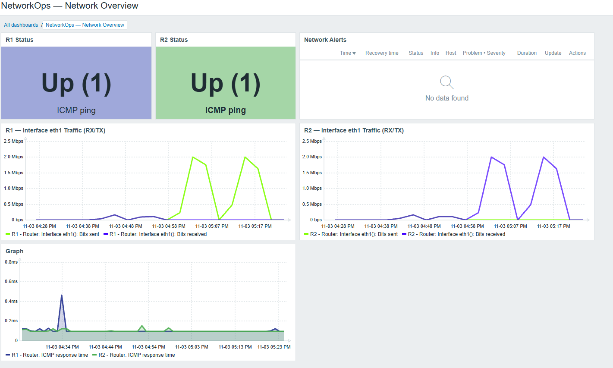

# NetworkOps

**Network Automation & Monitoring Lab**

A hands-on network engineering lab built with **Containerlab, FRRouting, Python, and Zabbix**. It demonstrates dynamic routing, configuration automation, interface and traffic monitoring, and controlled failure-and-recovery testing.

## Network Topology

```text
Host1                  R1                   R2                  Host2
192.168.10.10 ── 192.168.10.1 ── 10.0.12.1/30 ── 10.0.12.2/30 ── 192.168.20.1 ── 192.168.20.10
     LAN 1             eth2         eth1    OSPF    eth1        eth2              LAN 2
```

- **LAN 1:** `192.168.10.0/24`
- **Inter-router link:** `10.0.12.0/30`
- **LAN 2:** `192.168.20.0/24`
- **Dynamic routing:** OSPF Area 0
- **Management:** Docker's `clab` network, separate from the tested inter-router link

The infrastructure consists of two FRRouting routers and two Alpine Linux hosts, orchestrated with Containerlab and Docker.

## Features

- **Routing:** OSPF neighbor establishment, route exchange, and end-to-end connectivity between LANs.
- **SSH automation:** Key-based authentication, remote router commands, configuration backups, and configuration drift comparison.
- **Monitoring:** Zabbix dashboards with ICMP availability and latency, SNMP interface discovery, operational status, bandwidth, and interface counters.
- **Monitoring setup:** Python-based discovery and synchronization of router management addresses and Zabbix hosts.
- **Failure testing:** Interactive Python workflow that disables the R1–R2 link, validates OSPF and connectivity loss, and attempts link restoration with recovery checks.
- **Testing and CI:** Unit tests with pytest, plus GitHub Actions for syntax checks, tests, and Python dependency auditing with `pip-audit`.

## Monitoring Dashboard



The dashboard displays router availability, latency, interface traffic and network alerts. See [Monitoring](docs/monitoring.md) for setup details and observed throughput results.

## Technology Stack

| Area | Tools |
| --- | --- |
| Networking | FRRouting, OSPF, IPv4, SSH, SNMPv2c |
| Infrastructure | Linux, Docker, Containerlab, Docker Compose |
| Automation | Python, Paramiko |
| Monitoring | Zabbix 7.0, Net-SNMP, PostgreSQL |
| Quality and security | pytest, GitHub Actions, pip-audit, Gitleaks |

## Quick Start

**Prerequisites:** Linux or WSL2, Docker Engine, Containerlab, and Python 3.

Clone the repository and install Python dependencies:

```bash
git clone https://github.com/bruno-monteiro5/networkops.git
cd networkops
python3 -m venv .venv
source .venv/bin/activate
python -m pip install -r requirements-dev.txt
```

Build the router image with SNMP support and deploy the network:

```bash
docker build -t networkops/frr-snmp:10.7.1 -f lab/images/frr-snmp/Dockerfile .
containerlab deploy -t lab/topology.clab.yml
```

Verify routing and connectivity:

```bash
docker exec clab-networkops-r1 vtysh -c "show ip ospf neighbor"
docker exec clab-networkops-r1 vtysh -c "show ip route ospf"
docker exec clab-networkops-host1 ping -c 3 192.168.20.10
```

### Python Automation

After configuring the lab's SSH key authentication and trusted host keys, run:

```bash
python automation/check_ssh.py
python automation/run_commands.py
python automation/backup_configs.py
python automation/compare_configs.py r1
```

### Zabbix Monitoring

Create `monitoring/.env` with `ZABBIX_DB_PASSWORD` set to a local, private password. Start the services:

```bash
cd monitoring
docker compose up -d
cd ..
```

Open `http://localhost:8080`. Import the [SNMP interface template](monitoring/templates/interfaces_by_snmp.yaml), configure a Zabbix API token in your shell as `ZABBIX_API_TOKEN`, and register the routers:

```bash
python monitoring/register_hosts.py --dry-run
python monitoring/register_hosts.py
```

Follow the detailed [monitoring guide](docs/monitoring.md) for Zabbix setup.

### Tests and Failure Simulation

Run unit tests without touching the network:

```bash
python -m pytest -q
```

Run the **read-only** network preflight:

```bash
python automation/network_failure.py
```

Run the **interactive** link failure test (disrupts the R1–R2 connection):

```bash
python automation/network_failure.py --run
```

The script attempts to restore R1 `eth1` using `try/finally`. Zabbix alert creation and resolution are **verified manually**, not asserted through the API. Read the [failure-testing guide](docs/failure-testing.md) before running the disruptive test.

## Validation and Security

- OSPF adjacency, learned routes, and host-to-host connectivity validated in the running lab.
- Zabbix SNMP interface monitoring and `Link down` / recovery alerts observed.
- Interactive link-failure-and-recovery test completed successfully.
- Python unit tests and dependency auditing run in GitHub Actions on pushes and pull requests.
- Dependency audit and Gitleaks scan reported no findings at the time of validation; this is not a guarantee of security.

**Security note:** SNMPv2c uses a plaintext community string in this isolated lab. For production, use SNMPv3 and appropriate network access controls. Database passwords, API tokens, SSH private keys, and generated configuration backups should remain outside version control.

## Documentation

- [Monitoring setup and validation](docs/monitoring.md)
- [Failure detection and recovery](docs/failure-testing.md)
- [Automated CI workflow](.github/workflows/ci.yml)
