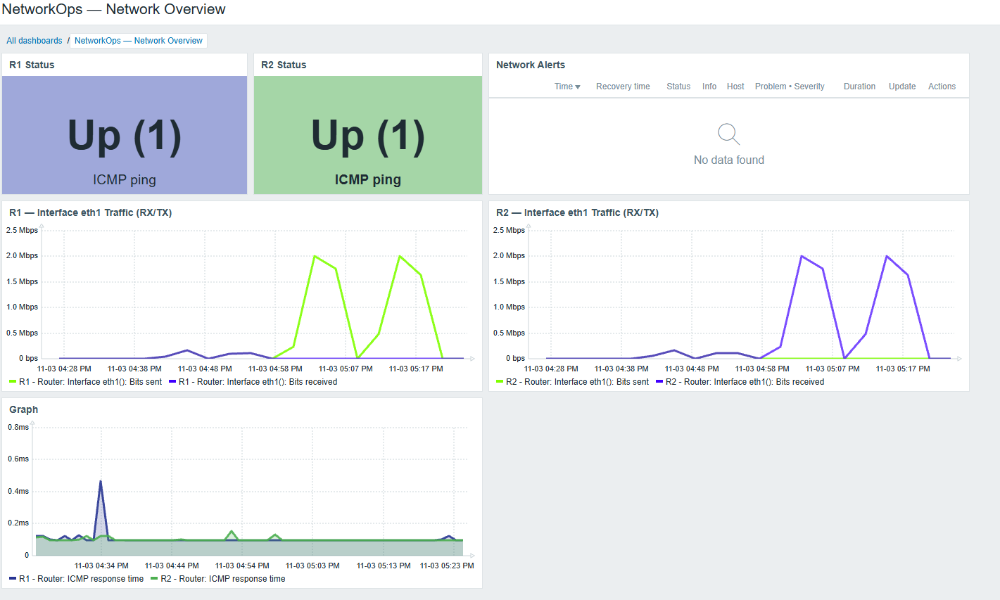

# Network Monitoring — Zabbix

## Overview

NetworkOps uses Zabbix 7.0 to monitor a virtual network
built with Containerlab and FRRouting.

The monitoring stack runs in Docker Compose and connects
to the Containerlab management network.

## Monitoring Features

- ICMP availability monitoring for R1 and R2
- Network latency monitoring
- Automatic network interface discovery using SNMPv2c
- Interface status, bandwidth, errors and discards
- Network failure detection and recovery alerts
- Automated host registration and synchronization via Python
- RX/TX traffic visualization using Zabbix dashboards

## Architecture

| Component | Purpose |
|-----------|---------|
| FRRouting | Virtual routers running OSPF |
| Net-SNMP | SNMP agent on R1 and R2 |
| Zabbix Server | Monitoring and alerting |
| PostgreSQL | Monitoring data storage |
| Zabbix Web | Dashboards and visualization |
| Python | Automated host synchronization |

## Deployment

### 1. Deploy the network

Build the custom FRRouting image:

```bash
docker build -t networkops/frr-snmp:10.7.1 \
  -f lab/images/frr-snmp/Dockerfile .
```

Deploy the topology:

```bash
containerlab deploy -t lab/topology.clab.yml
```

### 2. Start Zabbix

Configure the database credentials in
`monitoring/.env` and start the monitoring services:

```bash
cd monitoring
docker compose up -d
```

Access the web interface at:

http://localhost:8080

### 3. Configure monitoring

Import the `Interfaces by SNMP` template into Zabbix.

Create a Zabbix API token and expose it through
the `ZABBIX_API_TOKEN` environment variable.

Synchronize the routers:

```bash
python monitoring/register_hosts.py --dry-run
python monitoring/register_hosts.py
```

Run the Python commands from the repository root.

The script automatically discovers Docker management
IPv4 addresses and configures ICMP and SNMP monitoring.

## Validation

### ICMP and failure detection

A controlled management interface failure was simulated
on R1 and successfully detected by Zabbix.

The monitoring system generated an availability alert
and recovered after connectivity was restored.

### SNMP interface monitoring

Zabbix successfully discovered interfaces eth0, eth1
and eth2 on both routers.

Collected metrics include:

- Operational status
- Inbound and outbound traffic
- Interface speed
- Interface errors and discarded packets

### Traffic generation

Traffic was generated between Host1 and Host2 using iperf3.

A TCP throughput test achieved approximately 2.1 Mbps.

Zabbix recorded approximately 2 Mbps on:

- R1 eth1 — outbound traffic
- R2 eth1 — inbound traffic

This confirmed that SNMP monitoring accurately reflected
the traffic flowing between the routers.

## Dashboard



## Security Notes

SNMPv2c is used only within the isolated virtual lab.
Production deployments should use SNMPv3 with authentication
and encryption.

API tokens, database credentials and other secrets
must not be committed to the repository.
